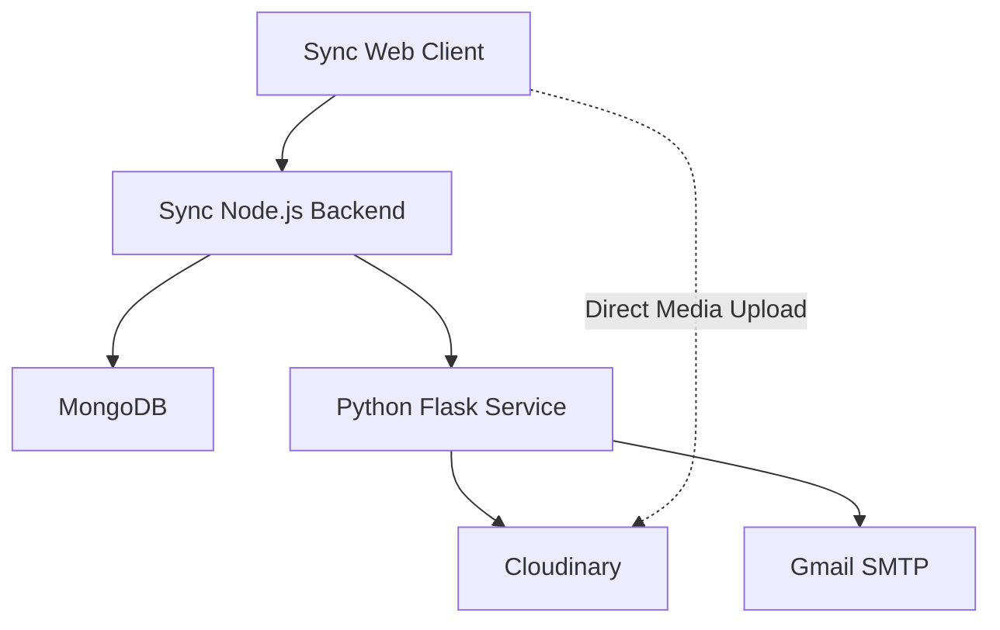

# Sync Python Media Upload Service

A lightweight Flask-based companion service built for **[Sync](https://github.com/duttaanubhab777-code/sync)** — a real-time communication platform.

This service handles secure media upload signing and email delivery for Sync. It is designed to work alongside the main Sync backend, keeping sensitive credentials and service-level operations away from the browser.

<p align="center">
  <a href="https://github.com/duttaanubhab777-code/sync">
    
  </a>
  <a href="https://sync-5lfm.onrender.com">
    
  </a>
  
  
</p>

---

## Overview

The Sync Python service is a dedicated backend component responsible for selected operations that are handled separately from the primary Node.js backend.

It currently provides two main capabilities:

- **Cloudinary media signing:** Generates secure upload signatures so clients can upload media directly to Cloudinary.
- **Email relay:** Sends application emails, including signup OTP emails, through configured Gmail SMTP credentials.

The service does not replace the main Sync backend. It works as a supporting microservice.

## Architecture



### How it works

1. The Sync client communicates with the main Node.js backend.
2. The Node.js backend requests the required operation from the Python service.
3. The Python service validates requests and handles signing or email delivery.
4. Media files are uploaded directly from the client to Cloudinary using signed upload parameters.
5. Email messages are delivered through the configured SMTP account.

## Features

### 1. Secure Cloudinary Media Upload

The service generates signed Cloudinary upload parameters.

Supported upload purposes include:

| Purpose | Description |
|---|---|
| `chat` | Chat attachments |
| `voice` | Voice messages |
| `avatar` | User profile pictures |
| `story` | User stories |
| `group` | Group media |
| `notice` | Notice attachments |

**Important:** The Python service signs uploads; it does not act as a file-storage server or proxy all uploaded media through itself.

### 2. Email Relay

The email service provides SMTP-based email delivery for Sync.

Features include:

- Signup OTP email delivery
- SMTP SSL and STARTTLS support
- Shared-secret verification
- Origin validation
- Recipient-based rate limiting
- SMTP diagnostic endpoint

### 3. Health Monitoring

A health endpoint is available to check whether the service is responding.

### 4. Security

- Environment-based configuration
- JWT compatibility utilities
- Request validation
- Protected internal service endpoints
- Credential separation between frontend and backend

---

## API Reference

The following endpoints are exposed by the service.

| Method | Endpoint | Purpose |
|---|---|---|
| `GET` | `/health` | Health check |
| `POST` | `/media/sign` | Generate Cloudinary upload signature |
| `POST` | `/mail/send` | Send an email |
| `GET` | `/mail/diag` | SMTP diagnostics |

### Health Check

```http
GET /health
```

Use this endpoint to verify service availability.

### Generate Media Signature

```http
POST /media/sign
Content-Type: application/json
```

Example request:

```json
{
  "purpose": "chat"
}
```

The service validates the requested purpose and returns the corresponding signed upload parameters.

### Send Email

```http
POST /mail/send
Content-Type: application/json
```

The request must follow the service's configured authentication and validation requirements.

Do not expose the internal shared secret or SMTP credentials in frontend code.

### SMTP Diagnostics

```http
GET /mail/diag
```

Use this endpoint to inspect the configured SMTP service status. Protect this endpoint according to your deployment configuration.

---

## Project Structure

```text
sync_python_media_upload/
│
├── app.py
├── settings.py
├── config.example.py
├── pythonanywhere_wsgi.py
├── verify_install.py
├── requirements.txt
│
├── routes/
│   ├── health.py
│   ├── media.py
│   └── mail.py
│
├── services/
│   ├── cloudinary_service.py
│   └── mail_service.py
│
├── utils/
│   ├── jwt_utils.py
│   ├── security.py
│   └── responses.py
│
└── tests/
    ├── test_health.py
    ├── test_media_sign.py
    ├── test_mail_relay.py
    ├── test_settings.py
    └── test_jwt_compat_and_wsgi.py
```

---

## Getting Started

### Requirements

- Python 3.x
- pip
- Cloudinary account
- Gmail account with an app password (if using SMTP email delivery)

### 1. Clone the repository

```bash
git clone https://github.com/arnabadhikari777/sync_python_media_upload.git

cd sync_python_media_upload
```

### 2. Create a virtual environment

```bash
python -m venv .venv
```

Activate it:

**Windows**

```bash
.venv\Scripts\activate
```

**Linux / macOS**

```bash
source .venv/bin/activate
```

### 3. Install dependencies

```bash
pip install -r requirements.txt
```

### 4. Configure environment variables

Use `config.example.py` as a reference for the configuration required by the application.

Never commit real credentials or production secrets.

Typical configuration categories include:

| Configuration | Purpose |
|---|---|
| Cloudinary credentials | Media upload signing |
| SMTP username | Email sender account |
| SMTP password | SMTP authentication |
| SMTP port | SSL or STARTTLS configuration |
| Shared service secret | Internal request authentication |
| JWT configuration | Token verification compatibility |
| Allowed origins | Request-origin validation |

Use the exact variable names expected by `settings.py` and `config.example.py`.

### 5. Run the service

```bash
python app.py
```

The service will start using the host and port configured by the application.

---

## Testing

Run the test suite using:

```bash
python -m pytest
```

You can also verify the installation with:

```bash
python verify_install.py
```

---

## Deployment

The service is designed to support deployment on PythonAnywhere.

The repository includes:

```text
pythonanywhere_wsgi.py
```

Use this WSGI entry point when configuring the PythonAnywhere web application.

Before deployment:

1. Install the required dependencies.
2. Configure all required environment variables.
3. Verify Cloudinary credentials.
4. Configure SMTP credentials if email delivery is enabled.
5. Set the correct internal service secret.
6. Configure allowed origins.
7. Point the WSGI configuration to the application.
8. Test the health endpoint after deployment.

Keep all production credentials in the hosting provider's environment configuration.

---

## Security Guidelines

Security is important because this service handles internal application operations.

- Never commit `.env` files or production credentials.
- Never expose SMTP passwords or Cloudinary API secrets to the frontend.
- Keep the shared service secret private.
- Restrict internal endpoints to trusted callers.
- Configure allowed origins carefully.
- Use HTTPS in production.
- Apply appropriate rate limits.
- Rotate credentials if they are accidentally exposed.

---

## Integration with Sync

This repository is part of the larger Sync ecosystem.

| Project | Description |
|---|---|
| [Sync](https://github.com/duttaanubhab777-code/sync) | Main communication platform |
| [Sync Live](https://sync-5lfm.onrender.com) | Live application |
| Sync Python Service | Supporting Flask microservice |

The main Sync repository also contains a corresponding `python-service/` directory.

The standalone repository and the main repository's service directory should remain synchronized when service code is updated.

For additional implementation details, refer to the main repository documentation:

- [API Documentation](https://github.com/duttaanubhab777-code/sync/blob/main/docs/API.md)
- [PythonAnywhere Deployment Guide](https://github.com/duttaanubhab777-code/sync/blob/main/docs/PYTHONANYWHERE_DEPLOYMENT_GUIDE.md)
- [OTP and Mail Relay Setup Guide](https://github.com/duttaanubhab777-code/sync/blob/main/docs/OTP_AND_MAIL_RELAY_SETUP_GUIDE.md)

---

## Contributing

Contributions, bug reports, and improvements are welcome.

When contributing:

1. Keep the service compatible with the main Sync backend.
2. Follow the existing project structure.
3. Add or update tests when changing functionality.
4. Never commit credentials or sensitive configuration.
5. Update documentation when introducing new endpoints or configuration options.

---

## License

This project is distributed under the license specified in the repository.

---

<p align="center">
  Built as part of the <a href="https://github.com/duttaanubhab777-code/sync"><strong>Sync ecosystem</strong></a>.
</p>
